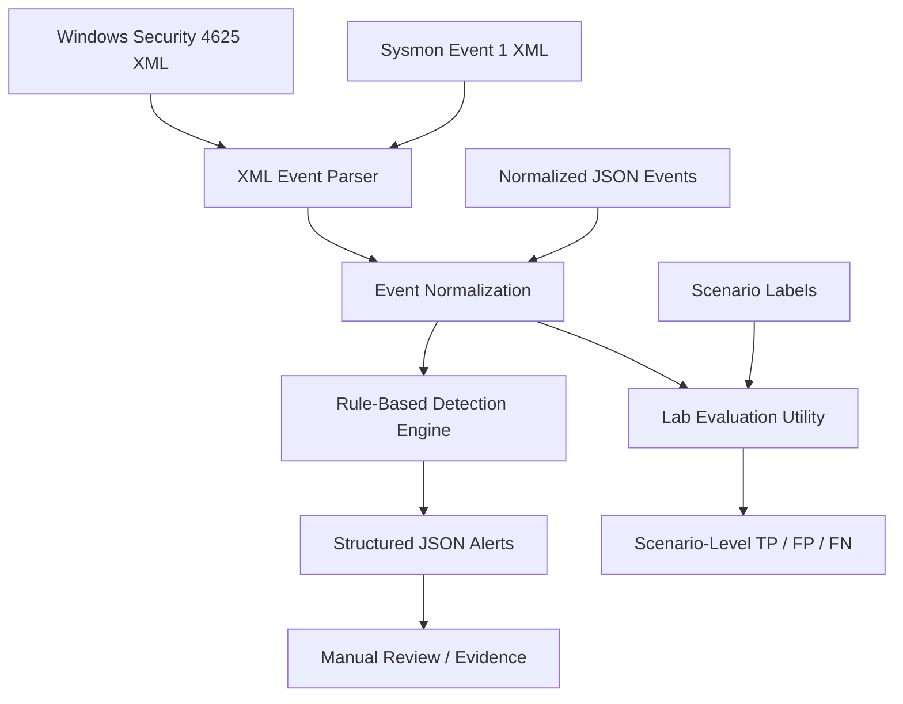

<div align="center">

# 🛡️ Windows / Sysmon Threat Detection

### Lightweight, Explainable Detection Engineering for Windows Event Logs

**CyberFox Society — Cybersecurity R&D Internship | Final MVP**

[](https://www.python.org/)


**Offline event ingestion · XML / JSON parsing · Rule-based detection · Structured alerts · Reproducible evaluation**

</div>

---

## Overview

Windows Security and Sysmon can record valuable security telemetry, but raw event records are difficult to review manually at scale. **Windows / Sysmon Threat Detection** is an offline, Python-based proof of concept that converts selected Windows event exports into normalized records, applies transparent detection rules, and generates machine-readable alerts.

The project was developed as a staged cybersecurity R&D internship deliverable, progressing from synthetic JSON-based detection to Windows Event XML parsing and a reproducible lab-validation workflow.

> [!IMPORTANT]
> **Evidence status:** The bundled examples and automated tests use **synthetic data**. The repository provides the tools and procedure to test authorized Windows/Sysmon exports, but **does not establish detection accuracy or reliability on real logs until those tests are performed and documented**. This is not a production SIEM or EDR.

## Key Capabilities

- **Two input formats:** normalized JSON arrays and exported Windows Event XML (`.xml`).
- **Windows Security Event ID 4625:** detects bursts of failed authentication attempts grouped by host, source IP, and target username.
- **Sysmon Event ID 1:** identifies selected suspicious-looking PowerShell process arguments.
- **Explainable output:** structured JSON alerts with rule IDs, severity, timestamps, reasons, and supporting evidence.
- **Configurable thresholds:** adjust the failed-logon count and time window from the command line.
- **Automated regression tests:** unit tests for parsing and detection logic.
- **Real-log evaluation workflow:** PowerShell export script, lab procedure, scenario-label template, and scenario-level scoring utility.
- **Minimal setup:** Python standard library only; no external Python packages required.

## Architecture



**Processing flow:** exported logs → XML parser or JSON loader → normalized events → rule evaluation → JSON alerts. The evaluation utility independently reruns detection against separately labeled scenario files.

## Detection Rules

| Rule ID | Source / Event ID | Detection logic | Severity |
|---|---|---|---|
| `REPEATED_FAILED_LOGINS` | Windows Security / `4625` | At least **5** failed logons within **10 minutes**, sharing host, non-loopback source IP, and target username | High |
| `PS_SUSPICIOUS_ARGS` | Sysmon / `1` | `powershell.exe` or `pwsh.exe` launched with `-EncodedCommand` / `-enc`, or with both `-NoProfile` and `-WindowStyle Hidden` | Medium |

These are **heuristics, not proof of malicious activity**. Legitimate administrative PowerShell commands may trigger alerts. Local authentication failures without a usable source IP may not meet the first rule's conditions.

## Quick Start

### Requirements

- Python **3.9+** recommended
- Windows, Linux, or macOS to run the offline detector
- Windows with Security auditing and Sysmon configured **only if collecting real Windows events**

Clone the repository:

```bash
git clone https://github.com/olaelneno/windows-sysmon-threat-detection.git
cd windows-sysmon-threat-detection
```

Run automated tests:

```bash
python -m unittest discover -s tests -v
```

Analyze the included **synthetic XML** example:

```bash
python src/detector.py --input data/sample_events.xml --output output/sample_xml_alerts.json
```

Analyze the included **synthetic JSON** example:

```bash
python src/detector.py --input data/sample_events.json --output output/sample_json_alerts.json
```

Adjust the failed-logon detection settings:

```bash
python src/detector.py --input data/sample_events.xml --output output/custom_alerts.json --threshold 5 --window-minutes 10
```

The tool prints a summary and saves alerts as JSON. Run commands from the repository root.

## Example Alert

*Illustrative output using synthetic test events (not a real incident):*

```json
{
  "rule_id": "REPEATED_FAILED_LOGINS",
  "severity": "high",
  "timestamp": "2026-10-14T12:04:00+00:00",
  "host": "LAB-PC",
  "user": "labuser",
  "source": "Security",
  "event_id": 4625,
  "reason": "5 failed logons from 192.0.2.10 targeting labuser within 10 minutes",
  "evidence": {
    "ip_address": "192.0.2.10",
    "target_user_name": "labuser",
    "count": 5
  }
}
```

`192.0.2.10` belongs to a documentation-only IP range.

## Real Windows / Sysmon Lab Validation

This is the **highest-priority outstanding validation step** from the internship feedback.

1. Prepare a Windows VM or device that you own or are explicitly authorized to test. Record OS version, audit settings, and Sysmon configuration.
2. Generate **controlled positive and negative scenarios** and confirm the expected events appear in Windows Event Viewer. For failed-logon testing, use only an authorized lab account and avoid account lockouts.
3. Open **PowerShell as Administrator** from the repository root and export the supported events:

   ```powershell
   powershell -ExecutionPolicy Bypass -File docs/Windows_Lab_Export.ps1 -OutputDir lab_exports
   ```

4. Run the detector against the exported XML:

   ```powershell
   python src/detector.py --input lab_exports/lab_security.xml --output output/lab_security_alerts.json
   python src/detector.py --input lab_exports/lab_sysmon.xml --output output/lab_sysmon_alerts.json
   ```

5. For reproducible evaluation, create **separate XML exports per scenario** and annotate expected rule IDs in a **private copy** of `evaluation/lab_manifest_TEMPLATE.json`, saved as `evaluation/lab_manifest.json`. Paths in the manifest are resolved relative to the manifest's folder.
6. Run the scenario-level evaluator:

   ```bash
   python evaluation/evaluate_lab.py --manifest evaluation/lab_manifest.json --output output/lab_evaluation.json
   ```

7. Manually cross-check each result with Event Viewer, investigate mismatches, and record redacted screenshots and observations.

See the full checklist in **[`docs/Week4_Lab_Validation.md`](docs/Week4_Lab_Validation.md)**.

### Evaluation Interpretation

The evaluator reports **scenario-level** true positives (TP), false positives (FP), false negatives (FN), precision, and recall by comparing detected **rule presence** with expected rule IDs. These are **not per-event classification metrics** and should not be presented as a production accuracy benchmark. No real-log precision or recall value is claimed in this repository.

## Project Structure

```text
windows-sysmon-threat-detection/
├── src/
│   ├── detector.py                 # CLI, normalization, and detection rules
│   └── xml_parser.py               # Windows Event XML ingestion
├── tests/
│   ├── test_detector.py            # Rule and input tests
│   └── test_xml_parser.py          # XML parsing tests
├── data/
│   ├── sample_events.json          # Synthetic normalized records
│   └── sample_events.xml           # Synthetic Windows Event XML
├── evaluation/
│   ├── evaluate_lab.py             # Scenario-level evaluation
│   └── lab_manifest_TEMPLATE.json  # Expected-rule labels template
├── docs/
│   ├── Windows_Lab_Export.ps1      # Authorized lab XML export
│   ├── Week4_Lab_Validation.md     # Validation procedure and checklist
│   ├── Week2_Submission.md
│   ├── Week3_Submission.md
│   ├── Final_Report.pdf            # Two-page project report
│   └── Final_Presentation.pptx     # Five-slide final presentation
├── output/                         # Example synthetic outputs
├── .gitignore
└── README.md
```

## Development Milestones

| Phase | Focus | Outcome |
|---|---|---|
| Week 1 | Research and problem definition | Selected Windows/Sysmon detection engineering problem and reviewed existing approaches |
| Week 2 | Initial MVP | Normalized JSON ingestion, two detection rules, structured alerts, and unit tests |
| Week 3 | Further development | Windows Event XML parser, XML test coverage, and lab export workflow |
| Week 4 | Validation and final delivery | Scenario evaluation utility, documented lab procedure, final report and presentation; **real-log validation pending** |

## Limitations and Future Work

**Current limitations**

- Supports selected **Security 4625** and **Sysmon 1** events only.
- Reads exported XML or normalized JSON; **does not directly parse binary `.evtx` files**.
- No live event streaming, agent deployment, dashboard, or SIEM integration.
- Rules may generate false positives or miss attacks outside their narrow patterns.
- Real-log reliability, precision, and recall are **not yet established**.

**Potential next steps**

- Complete and publish **redacted, authorized lab validation evidence**.
- Expand coverage to additional Windows/Sysmon events and tune rules using measured results.
- Add direct EVTX ingestion, richer correlation, configurable rules, and structured logging.
- Evaluate false positives with realistic benign administrative activity.
- Explore Sigma-compatible detections and SIEM integration after validation.

## Responsible Use and Data Handling

Use this project only on systems and logs you are authorized to access. Windows event logs may contain usernames, IP addresses, hostnames, process arguments, and other sensitive information. **Never commit raw lab logs, credentials, secrets, or identifying evidence to a public repository.** Keep lab exports and private manifests out of version control; publish only carefully redacted samples and aggregate results.

## Final Internship Deliverables

- 📊 [Five-slide presentation](docs/Final_Presentation.pptx)
- 📄 [Two-page project report](docs/Final_Report.pdf)
- 💻 [GitHub source repository](https://github.com/olaelneno/windows-sysmon-threat-detection)

## References

- [Microsoft Sysmon documentation](https://learn.microsoft.com/en-us/sysinternals/downloads/sysmon)
- [Microsoft Sysmon event reference](https://learn.microsoft.com/en-us/windows/security/operating-system-security/sysmon/sysmon-events)
- [PowerShell `Get-WinEvent`](https://learn.microsoft.com/en-us/powershell/module/microsoft.powershell.diagnostics/get-winevent)
- [MITRE ATT&CK — Brute Force (T1110)](https://attack.mitre.org/techniques/T1110/)
- [MITRE ATT&CK — PowerShell (T1059.001)](https://attack.mitre.org/techniques/T1059/001/)

---

<div align="center">

**Built as a CyberFox Society Cybersecurity R&D internship MVP.**

*Detect transparently. Test reproducibly. Report evidence honestly.*

</div>
